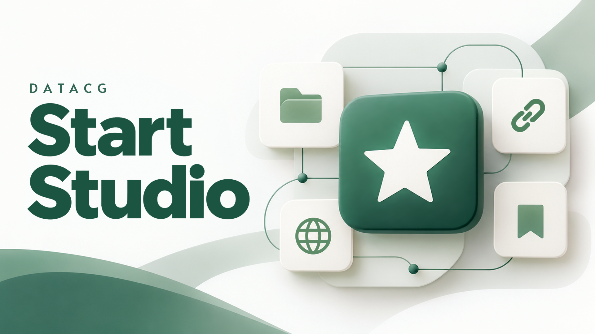

# Start Studio

A visual editor for personal start pages, developed by **Juliano Oliveira / DATACG**.

Organize your links into collections, customize symbols, emojis, favicons, and appearance, and use your saved HTML pages offline. The interface is available in Brazilian Portuguese, US English, Danish, and Italian. New installations start empty, with no personal links or data.

## Download for Windows

**[Download the latest release](https://github.com/datacg/startstudio/releases/latest)**

Open the release page and download `Start-Studio-Setup-<version>-x64.exe`. The application includes the components it needs; you do not need to install Node.js or Git. The installer lets you choose separate folders for the application and your pages.

See what changed in each version in the [release notes](CHANGELOG.md). Once installed, Start Studio can update itself: use **Check for updates** on the My pages screen.

**The current installer is not digitally signed. Windows may display security warnings.** Each release lists its version and includes a `.sha256` file so you can verify the download.

In PowerShell, run the following command and compare its result with the release checksum. Replace the example filename with the name of your downloaded installer:

```powershell
Get-FileHash '.\Start-Studio-Setup-<version>-x64.exe' -Algorithm SHA256
```

<a id="se-o-microsoft-edge-mostrar-um-aviso-no-download"></a>

### If Microsoft Edge displays a download warning

Edge may report that the installer **“isn't commonly downloaded.”** If you have verified that the download comes from this repository and have decided to continue, follow these steps. Button labels may vary depending on your browser version and language.

1. Open Edge's **Downloads** panel using the download icon or **Ctrl+J**.
2. Hover over the warning next to `Start-Studio-Setup-<version>-x64.exe`. Click the file's **three-dot menu (…)** and select **Keep**.
3. In the confirmation dialog, click the **down arrow (▼) next to Delete**, then select **Keep anyway**. Clicking **Delete** itself removes the download.
4. Wait for the download to finish. Open the installer from your Downloads folder and follow the setup wizard.

Some Edge versions require you to select **Show more** before **Keep anyway** appears. [Microsoft's documentation](https://learn.microsoft.com/en-us/troubleshoot/microsoft-edge/development/download-failures#check-security-and-smartscreen-settings) describes this process. These instructions apply to the uncommon-download warning and do not require disabling SmartScreen or antivirus protection.

## Your files

Changes made in the application are saved in your chosen pages folder. Your HTML pages, embedded images, and backups are stored separately from the application. Set `start.html` as your browser's start page. The application lets you move the data folder, export your pages, and restore backups as new pages.

This repository contains product information and distribution files only. The installer does not include a personal link library.

## Privacy

Start Studio does not require an account and does not collect usage data. It connects to the internet only when you ask it to: to download favicons for your links or to check for updates. Your pages work offline, with images embedded in the HTML files.

## Built with

Start Studio is a Windows desktop application. Its editor and the pages it creates are written in plain JavaScript, HTML, and CSS, without a front-end framework.

| Area | Tools |
| --- | --- |
| Languages | JavaScript (ES modules), HTML, CSS |
| Desktop application | [Electron](https://www.electronjs.org/), which bundles Chromium and Node.js |
| Installer and updates | [electron-builder](https://www.electron.build/) (NSIS installer for Windows x64) and electron-updater, with updates delivered through GitHub Releases |
| Testing | Node.js test runner, [Playwright](https://playwright.dev/) for browser and desktop tests, and [axe-core](https://github.com/dequelabs/axe-core) for WCAG accessibility checks |
| Code style | [Prettier](https://prettier.io/) |
| Build and release | GitHub Actions on Windows, which runs every test before building the installer for a release |
| Interface languages | Brazilian Portuguese, US English, Danish, and Italian |

**Development.** Designed and developed by Juliano Oliveira (DATACG), with AI coding assistants: [Codex](https://openai.com/codex/) by OpenAI and [Claude Code](https://www.anthropic.com/claude-code) by Anthropic.

## Support development

Start Studio is free to use. If it makes your day easier, you can make a voluntary contribution to support its development and other free DATACG projects.

**[Support DATACG on Ko-fi](https://ko-fi.com/datacg)**

[Visit the Start Studio page on DATACG](https://datacg.net/startstudio/)
